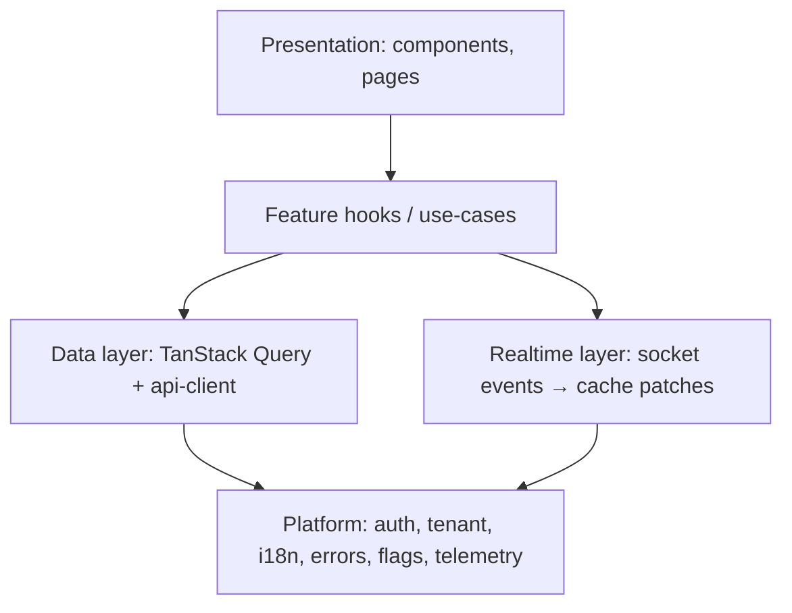
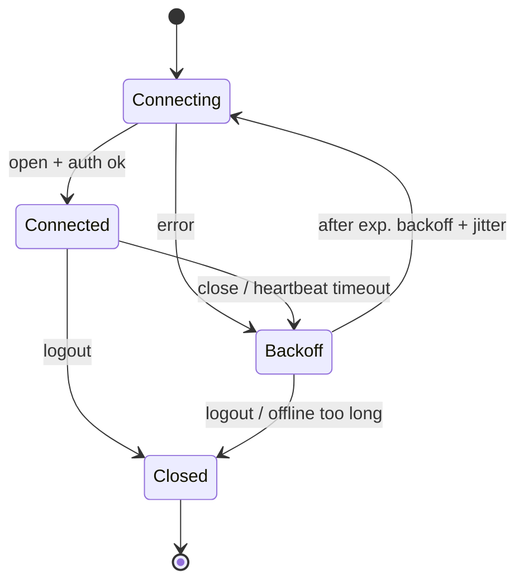
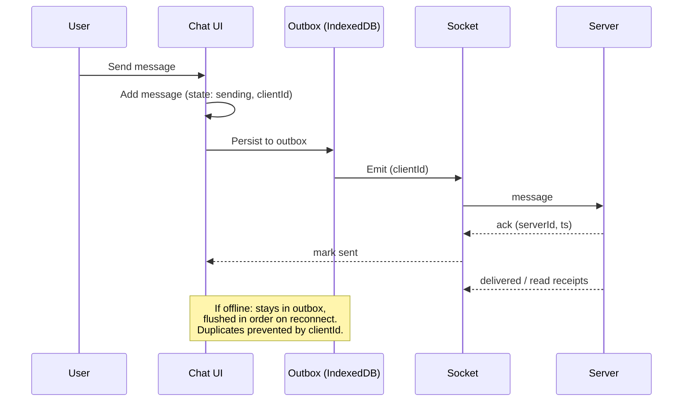
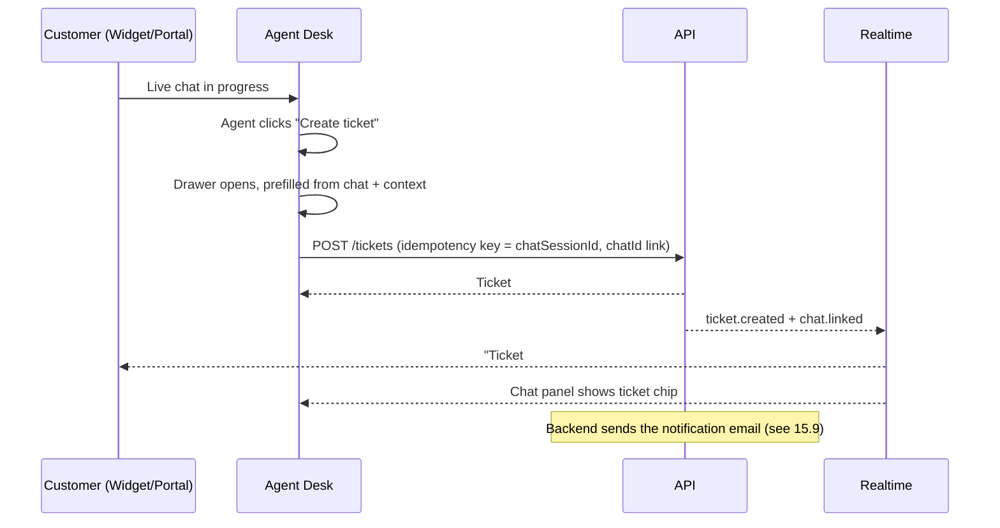

# Client-Side Architecture: B2B Customer Support System

**Status:** Draft v1 · **Scope:** Everything that runs in the browser (portal, agent desk, admin console, embeddable widget) and how it talks to the backend.
**Out of scope:** Backend services, infrastructure, data model (covered separately).

---

## 1. Context and Assumptions

| Topic | Decision / Assumption |
|---|---|
| Customers | **B2B.** Customers are *organizations*; each has multiple end users (requesters, org admins). |
| Tenancy | **Multi-tenant.** The client must be tenant-aware (branding, SSO, data scoping). |
| Widget | **Required in v1.** Embeddable on customers' own sites and products. |
| Scale (assumed) | Up to ~500 concurrent agents, ~10k concurrent customer sessions, ~2k concurrent chats. Revisit with real numbers. |
| Team (assumed) | 4–8 frontend engineers, TypeScript-comfortable. |
| Browsers | Last 2 versions of Chrome, Edge, Firefox, Safari (incl. iOS Safari). |
| Compliance | WCAG 2.2 AA, GDPR-style privacy, audit-friendly behavior. |

Assumptions marked "assumed" should be validated before implementation starts.

---

## 2. Design Principles

1. **Separate by audience, share by package.** Four apps, one design system, one API client.
2. **Server state is not client state.** Server data lives in a query cache; UI state stays small and local.
3. **Real-time is an enhancement of correctness, not a replacement.** Sockets push hints; the cache and API remain the source of truth.
4. **The UI is untrusted.** Every permission check in the client is for convenience; the backend enforces.
5. **Fail soft.** Bad networks, dropped sockets and partial outages must degrade gracefully, never lose user input.
6. **Budgets over opinions.** Performance, accessibility and bundle size are enforced in CI.
7. **Boundaries over cleverness.** Strict dependency direction keeps a multi-year codebase maintainable.

---

## 3. System Architecture

```mermaid
graph TD
    %% Users & Entry Points
    subgraph Clients [Client Layer]
        Customer[Customer End User]
        OrgAdmin[Customer Org Admin]
        Agent[Support Agent]
        Admin[Internal Admin]
        HostSite["Customer's Own Website"]
    end

    %% Network & Security Layer
    subgraph Edge [Edge & Security Layer]
        DNS[Route 53 / DNS<br/>Tenant Subdomain / Custom Domain] --> WAF[Web Application Firewall]
        WAF --> CDN[Content Delivery Network / CloudFront]
        CDN --> ALB[Application Load Balancer]
    end

    %% Routing
    Customer --> DNS
    OrgAdmin --> DNS
    Agent --> DNS
    Admin --> DNS
    HostSite -->|Loads widget loader.js| DNS

    %% Frontend Applications
    subgraph Frontend [Client Applications - Monorepo Apps]
        Portal["Customer Portal - Next.js<br/>Help Center SSG/ISR, Tickets, Org Settings"]
        Widget["Embeddable Widget - Preact in iframe<br/>KB Deflection, Live Chat, Ticket Form"]
        Desk["Agent Desk - React SPA<br/>Queue, Ticket Workspace, Chat Panel, Create Ticket from Chat"]
        AdminApp["Admin Console - React SPA<br/>Tenants, SLA, Routing, Forms, Email Templates, Audit"]
    end

    CDN -->|Serve static bundles| Portal
    CDN -->|Serve static bundles| Widget
    CDN -->|Serve static bundles| Desk
    CDN -->|Serve static bundles| AdminApp

    %% Shared Packages
    subgraph SharedPkgs [Shared Client Packages]
        UIKit[ui - Design System and Tokens]
        TenantPkg[tenant - Resolution, Theming, Entitlements]
        AuthPkg[auth - OIDC PKCE, Guards, Permissions]
        ApiClient[api-client - Typed SDK from OpenAPI]
        RealtimeClient[realtime - Socket Manager, Outbox, SSE Fallback]
        I18n[i18n - ICU Messages, RTL]
        Obs[observability - Errors, Web Vitals, Trace IDs]
        Flags[feature flags client]
    end

    Portal --> SharedPkgs
    Widget --> SharedPkgs
    Desk --> SharedPkgs
    AdminApp --> SharedPkgs

    %% Client State & Storage
    subgraph ClientState [Client State & Storage]
        QueryCache[TanStack Query Cache<br/>Tenant and Org Scoped Keys]
        UIState[UI State<br/>Zustand + URL Params]
        IDB[(IndexedDB<br/>Drafts, Chat Outbox)]
        TokenMem[In-Memory Access Token]
    end

    ApiClient --> QueryCache
    RealtimeClient -->|Patch or invalidate| QueryCache
    RealtimeClient --> IDB
    AuthPkg --> TokenMem
    SharedPkgs --> UIState

    %% API Gateway Tier
    subgraph API_Gateway_Layer [API Gateway Tier]
        APIGW[API Gateway / BFF<br/>Cookies, Token Refresh, Rate Limiting]
        WSGW[WebSocket Gateway<br/>WSS with SSE / Long-poll Fallback]
    end

    ApiClient -.->|HTTPS REST via Edge| ALB
    RealtimeClient -.->|WSS / SSE via Edge| ALB
    ALB -->|API Traffic| APIGW
    ALB -->|Realtime Traffic| WSGW

    %% Application Services Tier
    subgraph Microservices [Application Logic Tier]
        APIGW --> AuthSvc[Authentication Service]
        APIGW --> TenantSvc[Tenant and Config Service<br/>Branding, Form Schemas, SLA, Rules]
        APIGW --> TicketSvc[Ticket Management Service]
        APIGW --> KBSvc[Knowledge Base Service]
        APIGW --> NotifSvc[Notification Service]
        WSGW --> ChatSvc[Real-time Live Chat Service]
    end

    ChatSvc -->|Create ticket from chat<br/>idempotency key = chat session| TicketSvc

    %% Asynchronous Processing
    subgraph Async_Layer [Event & Message Broker]
        TicketSvc -->|ticket.status_changed<br/>ticket.created| MessageQueue[RabbitMQ / AWS SQS]
        MessageQueue --> EmailWorker[Notification Worker<br/>Status-change Emails]
        MessageQueue --> FanoutWorker[Realtime Fan-out Worker]
    end

    EmailWorker --> NotifSvc
    FanoutWorker -->|Push events and email delivery status| WSGW

    %% Cache & Storage Tier
    subgraph Database_Layer [Data & Storage Tier]
        AuthSvc --> DB[(Relational DB / PostgreSQL)]
        TenantSvc --> DB
        TicketSvc --> DB
        KBSvc --> DB
        ChatSvc --> DB

        %% Caching
        TicketSvc --> Cache[(In-Memory Cache / Redis)]
        ChatSvc --> Cache
        WSGW --> Cache

        %% Search
        KBSvc --> SearchIdx[(Search Index / OpenSearch)]

        %% Unstructured Data
        TicketSvc --> ObjStorage[(Object Storage / S3 Attachments)]
    end

    %% Direct uploads and search from client
    ApiClient -.->|Pre-signed direct upload| ObjStorage
    ApiClient -.->|KB search queries| KBSvc

    %% Third-Party Integrations
    subgraph Third_Party [External SaaS Integrations]
        NotifSvc --> EmailSvc[SendGrid / Twilio SMS]
        EmailSvc -->|Automated status email| BizEmail[Customer Dedicated Business Email<br/>Verified Address]
        AuthSvc --> IdP[Tenant SSO / Auth0<br/>OIDC, SAML, MFA]
        TicketSvc --> CRM[Salesforce / Jira Sync]
        Obs --> Sentry[Error and RUM Vendor<br/>Sentry / Datadog]
    end

    AuthPkg <-->|OIDC Auth Code + PKCE| IdP
```



### 3.1 Why four apps and not one

| App | Audience | Key traits | Rendering |
|---|---|---|---|
| **Portal** | Customer users and org admins | SEO for Help Center, branded per tenant, light usage | SSG/ISR for KB, SPA routes for tickets |
| **Widget** | Customer users on *their own* sites | Tiny, isolated, third-party origin, must never break host page | Client-only, iframe + Shadow DOM |
| **Agent Desk** | Support agents | All-day use, real-time, keyboard-driven, multi-ticket | SPA |
| **Admin Console** | Internal admins | Form-heavy, config, audit | SPA |

Different audiences have different performance, security and UX needs. Forcing them into one bundle penalizes everyone.

---

## 4. Repository and Package Structure

A **monorepo** (pnpm workspaces + Turborepo or Nx).

```
/apps
  /portal          Customer portal (Next.js)
  /widget          Embeddable widget (Vite, library mode)
  /agent-desk      Agent dashboard (Vite + React)
  /admin           Admin console (Vite + React)
/packages
  /ui              Design system: tokens, primitives, composed components
  /api-client      Typed SDK generated from OpenAPI (+ hand-written wrappers)
  /realtime        Socket manager, event typing, outbox
  /auth            OIDC client, token store, guards, permission helpers
  /tenant          Tenant resolution, theming, feature entitlements
  /i18n            Message catalogs, formatters, locale detection
  /observability   Logging, error reporting, web vitals, trace IDs
  /config          Env schema, feature flags client
  /eslint-config, /tsconfig, /test-utils
```

### 4.1 Dependency rules (enforced by lint, e.g. `eslint-plugin-boundaries` or Nx module boundaries)

```
apps → features → shared packages
features ↛ other features      (communicate via shared packages or events)
shared packages ↛ apps
ui ↛ api-client                (design system has no data knowledge)
```

### 4.2 Feature-based layout inside each app

```
/src
  /app            Providers, router, layout shell
  /features
    /tickets
      /components   (feature-specific UI)
      /hooks        (useTicketList, useCreateTicket)
      /api          (query keys, fetchers, mutations)
      /state        (local UI state, if any)
      /routes
      index.ts      (public surface of the feature)
    /chat
    /knowledge-base
    /organization
    /notifications
  /shared           App-local helpers
```

---

## 5. Technology Choices (with rationale)

| Concern | Choice | Reason | Alternative |
|---|---|---|---|
| Language | TypeScript (strict) | Safety across a large surface | n/a |
| UI library | React 18+ | Ecosystem, hiring, shared across 3 apps | Vue 3 if team prefers |
| Portal framework | Next.js | SSG/ISR for KB SEO, tenant-aware middleware | Astro + islands for KB only |
| SPAs build | Vite | Fast dev and builds | n/a |
| Widget runtime | Preact (+ compat) in a Web Component | ~4 KB vs ~45 KB; bundle budget | Vanilla/Lit |
| Server state | TanStack Query | Caching, retries, dedupe, invalidation | RTK Query |
| UI state | Zustand (small stores) + React context | Minimal boilerplate | Redux Toolkit |
| Forms | React Hook Form + Zod | Schema shared with API types | Formik (not recommended) |
| Tables/lists | TanStack Table + TanStack Virtual | Large agent queues | AG Grid (if heavy needs) |
| Rich text | TipTap (ProseMirror) | Replies, canned responses, KB editing | Lexical |
| Styling | Tailwind + CSS variables (tokens) | Tenant theming via variables | CSS Modules |
| Primitives | Radix UI | Accessible behaviors | React Aria |
| Real-time | Native WebSocket wrapper + SSE fallback | Full control of reconnect/outbox | Socket.IO |
| Search UI | Backend index (Algolia/OpenSearch/Meilisearch) via API | Relevance, typo tolerance | n/a |
| i18n | FormatJS (ICU messages) | Plurals, RTL, formatting | i18next |
| Testing | Vitest, Testing Library, Playwright, Storybook, MSW | Full pyramid | Cypress |
| Observability | Sentry + Web Vitals + OpenTelemetry (browser) | Errors, perf, trace correlation | Datadog RUM |
| Flags | OpenFeature client + provider (Unleash/LaunchDarkly) | Vendor-neutral | n/a |

---

## 6. Layered Architecture Inside an App



- **Presentation** renders and handles interaction only.
- **Feature hooks** hold business logic (`useReplyToTicket`: optimistic update, error mapping, analytics).
- **Data layer** owns fetching, caching, retries, query keys.
- **Realtime layer** translates socket events into cache updates.
- **Platform** is cross-cutting and injected via providers.

---

## 7. Multi-Tenancy on the Client (B2B-specific)

### 7.1 Tenant resolution

Order of precedence:
1. Subdomain (`acme.support.example.com`) or custom domain (`help.acme.com`)
2. Widget embed key (`data-tenant-key`)
3. Claim in the access token (for agents, who span tenants)

Resolved once at app boot into a `TenantContext` containing: `tenantId`, branding tokens, enabled features/entitlements, SSO config, locale defaults.

### 7.2 Theming

- Brand colors, logo, fonts and radii are delivered as **design tokens** (JSON) and applied as CSS variables on `:root` (or the widget's shadow root).
- Contrast is validated: if a tenant color fails WCAG AA against its background, fall back to an accessible variant and warn in the admin console.

### 7.3 Organization model for customer users

- A customer user belongs to one or more **organizations**; roles per org (`requester`, `org_admin`, `viewer`).
- Org admins see all tickets of their org, manage users, view SLA/reporting. Requesters see own (or shared) tickets.
- The UI exposes an **org switcher** only when the user belongs to multiple orgs; the active org is part of every query key so caches never leak across orgs.

### 7.4 Agent cross-tenant safety

- The agent desk always shows the **active tenant** prominently (badge + color accent) to avoid replying in the wrong context.
- Query keys include `tenantId`; switching tenant clears tenant-scoped caches.
- Cross-tenant search is a distinct, clearly labeled mode.

---

## 8. Authentication and Authorization

### 8.1 Flows

| App | Method |
|---|---|
| Portal / Widget (customers) | OIDC Authorization Code + PKCE; **per-tenant SSO (SAML/OIDC)** where configured; magic link/email+MFA fallback |
| Widget (anonymous visitor) | Limited anonymous session, upgraded on identification |
| Widget (identified) | Host site passes a **signed JWT** (server-generated by the customer) so users are not asked to log in twice |
| Agent / Admin | Corporate SSO + MFA, short sessions, step-up for sensitive actions |

### 8.2 Token handling

- Access token: **memory only**, short-lived (5–15 min).
- Refresh token: **HttpOnly, Secure, SameSite cookie**, rotated on use, handled by the BFF.
- Silent refresh via single-flight: concurrent 401s trigger **one** refresh, others wait.
- On refresh failure: preserve unsent drafts locally, redirect to sign-in with a return URL.
- Cross-tab sync with `BroadcastChannel` (logout in one tab logs out all).

### 8.3 Authorization in the UI

- Permissions arrive as a list of capabilities (`ticket:assign`, `org:manage_users`), not only roles.
- `<Can permission="ticket:assign">` and `useCan()` gate UI; route guards gate navigation.
- The backend remains authoritative; a 403 is handled gracefully (friendly message, refresh permissions).

---

## 9. Data Fetching, Caching and State

### 9.1 Query key convention

```ts
['tenant', tenantId, 'org', orgId, 'tickets', 'list', { status, page }]
['tenant', tenantId, 'tickets', 'detail', ticketId]
```

Always includes tenant (and org when relevant). One factory function per feature produces keys; no inline strings.

### 9.2 Rules

| Case | Strategy |
|---|---|
| Lists | Cursor pagination; infinite scroll with virtualization in agent queues |
| Detail pages | Prefetch on hover/focus of list rows |
| Mutations (status, assign, reply) | Optimistic update + rollback + toast |
| Stale data | `staleTime` per resource (queues: seconds; KB: minutes; org settings: longer) |
| Retries | Network and 5xx only, backoff; never retry non-idempotent calls without an idempotency key |
| Pagination consistency | Cursor-based so live inserts don't shift pages |

### 9.3 Idempotency

Every create/reply mutation sends a client-generated `Idempotency-Key` (UUID). Double clicks and retries after timeouts never create duplicates.

### 9.4 Where state lives

| State | Location |
|---|---|
| Server data | TanStack Query cache |
| URL-addressable (filters, sort, selected ticket) | **URL** (search params), so views are shareable and refresh-safe |
| Ephemeral UI (open modal, panel sizes) | Component state / small Zustand store |
| Drafts | IndexedDB (autosaved), keyed by ticket + user |
| Preferences (theme, density, shortcuts) | Server-synced user settings + local cache |

---

## 10. Real-Time Architecture

### 10.1 Transport

- **WebSocket** primary, **SSE** fallback, **long-polling** last resort (corporate proxies in B2B environments often block sockets, so the fallback is a real requirement).
- One multiplexed connection per tab. For the agent desk, a **SharedWorker** (or leader-election via BroadcastChannel) keeps a single socket across tabs.

### 10.2 Connection manager



- Heartbeat (ping/pong) to detect half-open connections.
- Exponential backoff with jitter (1s → 30s cap).
- Pause when offline (`navigator.onLine` plus the `online` event) and when the tab is hidden for long periods (widget).
- On reconnect: resubscribe to channels, then **request missed events since `lastEventId`**.

### 10.3 Event handling

Events are typed and versioned (`{ type, version, tenantId, entityId, seq, payload }`).

| Event | Client action |
|---|---|
| `ticket.updated` | Patch the cache entry; if unknown shape, invalidate |
| `ticket.assigned` | Update queue lists, notify the assignee |
| `chat.message` | Append to chat store, update unread counters |
| `chat.typing` | Ephemeral state, auto-expire after ~4 s |
| `presence.changed` | Update agent availability indicators |
| `sla.breach_warning` | Highlight the ticket, raise an alert |

Events are **hints**: if sequence gaps are detected (`seq` jump), the client refetches the affected resource.

### 10.4 Chat message lifecycle (client-side)



States: `sending → sent → delivered → read`, or `failed` with a retry control.

---

## 11. Customer Portal

### 11.1 Rendering strategy

| Route | Strategy | Why |
|---|---|---|
| `/help`, `/help/articles/:slug` | **SSG + ISR**, revalidated on publish webhook | SEO, speed, CDN cache |
| `/help/search` | Client-side with server search API | Dynamic |
| `/tickets/**`, `/org/**` | Auth-gated SPA routes | Private data |
| `/status` (optional) | SSR with short cache | Fresh |

Tenant-specific help centers: per-tenant static generation keyed by hostname (middleware rewrites to `/_tenants/[tenant]/...`).

### 11.2 Core user journeys

1. **Self-serve:** search KB → article → "Did this help?" → resolved, or "Contact support."
2. **Ticket creation with deflection:** as the subject is typed (debounced), suggest articles; user can still submit.
3. **Ticket tracking:** list with status, filters, org-wide view for org admins, thread view with attachments.
4. **Org admin:** manage users, view org tickets, SLA summary, export.

### 11.3 Ticket creation form

- Multi-step, schema-driven form (fields vary per tenant/category, defined by server-delivered **form schema**, rendered by a generic field renderer).
- Zod validation generated from the same schema.
- Draft autosave; recover after refresh or session expiry.
- Attachments: pre-signed direct upload to object storage with progress, cancel and retry; type/size checks client-side (re-validated server-side); optional virus-scan status shown ("Scanning…" → "Ready").

---

## 12. Embeddable Widget (v1)

### 12.1 Embedding contract

```html
<script async src="https://widget.example.com/loader.js"
        data-tenant-key="pk_live_xxx"></script>
<script>
  window.SupportWidget('init', {
    user: { jwt: '<server-signed-token>' },   // optional identification
    locale: 'en',
    context: { plan: 'enterprise', page: location.pathname }
  });
</script>
```

- **loader.js** (~2 KB): creates the launcher and lazily loads the main bundle on first interaction.
- Public API: `init`, `open`, `close`, `identify`, `logout`, `on(event, cb)`, `setContext`.

### 12.2 Isolation

| Layer | Technique |
|---|---|
| Visual | Render in **iframe** (strongest) or Shadow DOM; no style leakage in either direction |
| Security | Iframe from a separate origin; host communicates by `postMessage` with strict origin checks; no host cookies/tokens exposed |
| Stability | Wrapped in try/catch and error boundaries; the widget must never throw into the host page |
| CSP friendliness | Documented required directives (`frame-src`, `connect-src`); no `eval`, no inline scripts |

### 12.3 Behaviors

- Anonymous → identified upgrade without losing the conversation.
- Pre-chat KB search (deflection), then chat or ticket form.
- Business hours and agent availability awareness (offline → ticket form).
- Mobile responsive full-screen mode; respects `prefers-reduced-motion`.
- Unread badge, optional sound, and persistent session across page navigations (state in the iframe's origin storage).

### 12.4 Budgets

| Metric | Budget |
|---|---|
| Loader | < 3 KB gzip |
| Main bundle | < 60 KB gzip (Preact) |
| Time to launcher visible | < 300 ms after load, with no layout shift on host page |
| Host page impact | No Lighthouse regression for host sites |

---

## 13. Agent Desk

### 13.1 Layout

Three-pane workspace: **Queue / views** → **Conversation + ticket thread** → **Context panel** (customer, org, SLA, related tickets, KB suggestions, internal notes). Multiple open tickets as tabs; panels resizable, state persisted.

### 13.2 Productivity features (high value for agents)

- Command palette (Cmd/Ctrl+K) and **keyboard shortcuts** for assign, reply, macro, next ticket.
- Canned responses/macros with variables (`{{customer.name}}`), searchable.
- Saved views and filters stored in URL + server.
- Bulk actions with undo.
- Collision detection: "Priya is also viewing/typing" (presence on ticket).
- Internal notes vs public replies with **clear visual distinction** and a confirm on ambiguous sends.
- Side conversations and @mentions to colleagues.
- Draft autosave per ticket.

### 13.3 Performance

- Virtualized queue (thousands of rows).
- Prefetch the next ticket in queue.
- Single socket across tabs (SharedWorker / leader election).
- Pause expensive subscriptions for background tabs.

### 13.4 Safety

- Active tenant badge always visible.
- Confirmation for high-risk actions (merge, delete, bulk close).
- Sensitive data masking (e.g. card numbers) with reveal-on-demand, audited server-side.

### 13.5 Creating a ticket from a live chat

An agent can raise a ticket at any point during (or after) a live chat, without retyping anything.

**Entry points**
- A persistent **"Create ticket"** button in the chat panel header, plus a keyboard shortcut and a command-palette action.
- A **"Convert to ticket"** option on a single message or selection (start the ticket from the problem statement).
- **Automatic prompts:** when a chat ends unresolved, or a visitor leaves/an agent is unavailable (missed chat), the desk offers one-click ticket creation; tenants can configure auto-creation in the admin console.

**What the form does**
- Opens as a side drawer so the chat stays visible.
- **Prefilled:** requester, organization, tenant, subject (suggested from the first customer message), description (summary or transcript excerpt), category, priority, plus page URL and context passed by the widget (plan, current page).
- Full transcript is attached as a read-only linked conversation, not pasted text.
- Agent can set assignee (default: self), status, tags and internal notes before saving.

**Linking behavior**
- The chat shows a **ticket reference chip** (e.g. `#12345`) once created; the ticket shows a "Created from chat" badge with a link back to the transcript.
- Later chat messages on the same session keep syncing to the ticket thread (a single conversation, not two copies).
- If a ticket already exists for this chat, the button changes to "Open ticket #12345", which prevents duplicates.
- Creation sends an **idempotency key** tied to the chat session ID, so double clicks or retries can't create two tickets.

**Customer side**
- The customer sees a message in the chat or widget such as "We've opened ticket #12345 for you" with a link to the portal, and the same reference arrives by email (see 15.9).
- If the customer is anonymous, the ticket creation step prompts for an email (or uses the identified widget JWT) so updates have somewhere to go.



---

## 14. Admin Console

- Config domains: tenants and branding, SLAs, routing/assignment rules, business hours, canned responses, forms and fields, integrations/webhooks, users/roles, audit log.
- **Schema-driven forms** for rule builders and form designers; JSON-schema backed validation.
- **Draft → preview → publish** workflow for rules and SLAs with a diff view and rollback.
- Audit log viewer with filters and export.
- Every change shows who/when; destructive operations require typed confirmation.

---

## 15. Cross-Cutting Concerns

### 15.1 Error handling

- Error boundaries at app, route and widget/panel levels.
- Normalized error shape: `{ code, message, traceId, details }`; the UI shows a human message plus a copyable **reference ID** for support.
- Differentiated handling: validation (inline), auth (re-login flow), permission (403 view), not found, network (retry banner), server (generic + trace ID).

### 15.2 Offline and resilience

- Offline banner; reads served from cache where safe.
- Mutations: queued only for safe/idempotent operations (chat messages, drafts); others fail with a clear retry option.
- Service worker (portal and agent desk) for asset caching; **no** caching of authenticated API responses at the SW level.

### 15.3 Security

| Risk | Mitigation |
|---|---|
| XSS (chat, ticket HTML, KB) | Sanitize with DOMPurify using an allowlist; render rich text through a controlled renderer; avoid `dangerouslySetInnerHTML` on raw data |
| Clickjacking | `frame-ancestors` (except the widget's own embed rules); widget iframe sandbox attributes |
| CSRF | SameSite cookies + CSRF token on cookie-authenticated calls |
| Token theft | No tokens in localStorage; short-lived access tokens |
| Malicious uploads | Type/size checks, server-side scanning, download via `Content-Disposition: attachment`, no inline rendering of untrusted HTML/SVG |
| Supply chain | Lockfile, `pnpm audit`/Renovate, SRI for third-party scripts, minimal dependencies |
| CSP | Strict CSP with nonces; report-only first, then enforce |
| Open redirects | Allowlist for return URLs |
| Link safety | `rel="noopener noreferrer"` on user-supplied links; warn on external links |

### 15.4 Accessibility (WCAG 2.2 AA)

- Radix/React Aria primitives; focus management on modals, route changes and new chat messages.
- `aria-live` regions for incoming messages (polite) and SLA alerts (assertive).
- Full keyboard operability including the widget and the command palette.
- Color contrast validated, including **per-tenant themes**.
- Automated (axe in CI + Storybook a11y) plus manual screen-reader passes before release.

### 15.5 Internationalization

- ICU messages; no string concatenation.
- Locale detection order: user setting → tenant default → browser.
- RTL support via logical CSS properties.
- Dates, numbers, time zones formatted per locale; agents see the **customer's local time** in context.
- KB content localization with fallback to default language and a "translated from…" indicator.

### 15.6 Observability

- Error reporting with release tags, tenant and user ID hash (no PII in payloads).
- Web Vitals (LCP, INP, CLS) segmented by app and route.
- A **trace ID** generated per request (W3C `traceparent`), echoed in error UIs and correlated with backend traces.
- Product analytics events through a thin abstraction (vendor-swappable), consent-aware.
- Widget-specific telemetry: load failures, time-to-ready, host domain.

### 15.7 Privacy

- Consent banner and analytics gating in the portal and widget where required.
- PII redaction in logs and session replay (replay disabled by default in the agent desk).
- Data export and deletion requests surfaced in the portal for org admins.

### 15.8 Feature flags and entitlements

- Flags for rollout (percentage, tenant, role); entitlements for plan-based features (e.g. chat only on enterprise plan). Both evaluated through the `tenant` package; UI hides, backend enforces.

### 15.9 Notifications and status-change emails

**Requirement:** when a ticket's status changes, an automated email goes to the customer organization's dedicated business email address.

**Ownership of responsibility**
- The **email is sent by the backend** (Notification Service), triggered by the `ticket.status_changed` event. The client never sends the email, because it must fire no matter who changed the status (agent, automation, API, SLA rule) and even if no browser is open.
- The client's job is to **configure it, show it, and make it trustworthy.**

**Client responsibilities**

| Where | What the client provides |
|---|---|
| **Portal: org settings (org admin)** | Set one or more **dedicated business email addresses** for the organization (e.g. `support@acme.com`), choose which status changes trigger an email, and send a test email. |
| **Verification** | A new address starts as "Pending"; the admin must click the confirmation link sent to it before it receives notifications. The UI shows Verified / Pending / Bounced states. |
| **Admin console (internal)** | Per-tenant templates (branded, localized, with variables like `{{ticket.id}}`, `{{old_status}}`, `{{new_status}}`, `{{portal_link}}`), default triggers, sender identity/domain status (SPF/DKIM), and template preview before publish. |
| **Agent desk** | Status change dialog shows **"A notification email will be sent to acme@..."** with an option to suppress or add a note when policy allows. Ticket timeline shows each email as an event (Sent / Delivered / Bounced / Failed). |
| **Portal ticket view** | Notification history for the ticket, and a link in every email that deep-links to the ticket (auth required). |
| **User preferences** | Individual users can set their own notification channels (email, in-app); org-level business address rules are separate from personal preferences. |

**Email content (template contract)**
- Subject: `[#12345] Status changed: In Progress → Resolved`.
- Body: ticket title, old and new status, who or what changed it (agent name or "Automation"), latest public reply (if any), link to the portal.
- Internal notes and agent-only data are **never** included.
- Localized to the organization's language; plain-text and HTML versions.

**Failure and trust behavior**
- Bounce/failure → visible warning to the org admin in the portal and an internal alert in the admin console.
- Dedupe: rapid consecutive status changes can be **batched within a short window** (configurable) to avoid email floods.
- Every email send is auditable (timestamp, recipient, template version).

**Related notification surfaces (same pipeline)**
- In-app notifications and unread badges via the realtime channel.
- Optional webhooks and SMS where entitled by the tenant plan.

---

## 16. Performance Strategy

| Area | Tactic |
|---|---|
| Bundles | Route-level code splitting; dynamic import for editors, charts, command palette; bundle analyzer in CI |
| Rendering | Virtualization; memoization only where profiled; avoid global re-render via selector-based stores |
| Network | HTTP/2/3, CDN, prefetch on intent, request dedupe, compression (Brotli) |
| Images/assets | Responsive images, lazy loading, modern formats |
| Fonts | Subset, `font-display: swap`, self-hosted |
| Third-party | Loaded after interaction/idle, isolated where possible |

**Budgets (enforced by Lighthouse CI / size-limit):**

| App | LCP | INP | CLS | Initial JS (gzip) |
|---|---|---|---|---|
| Portal (KB pages) | < 2.0 s | < 200 ms | < 0.1 | < 120 KB |
| Portal (app routes) | < 2.5 s | < 200 ms | < 0.1 | < 200 KB |
| Agent Desk | < 3.0 s (warm < 1.5 s) | < 150 ms | < 0.1 | < 350 KB (split) |
| Widget | n/a (launcher < 300 ms) | < 100 ms | 0 | < 60 KB |

---

## 17. Testing Strategy

| Layer | Tooling | Focus |
|---|---|---|
| Unit | Vitest | Utilities, reducers, schema validation, connection manager |
| Component | Testing Library + Storybook | States (loading/empty/error), accessibility |
| Contract | OpenAPI-generated types, MSW handlers, Pact (optional) | API drift detection |
| Integration | Vitest + MSW | Feature flows with mocked network |
| E2E | Playwright | Critical paths per app; cross-browser; widget embedded in a sample host page |
| Real-time | Custom fake socket server | Reconnect, duplicate, out-of-order, gap-fill scenarios |
| Visual | Storybook + Chromatic/Playwright snapshots | Design system regression, tenant themes |
| A11y | axe-core in CI, manual SR checks | WCAG regressions |
| Performance | Lighthouse CI, bundle-size limits | Budget enforcement |
| Resilience | Playwright with throttling/offline | Slow 3G, dropped sockets, token expiry mid-action |

**Critical E2E paths:** sign in (SSO), search KB → deflect, create ticket with attachment, agent receives and replies, customer sees the reply in real time, chat reconnect after network loss, org admin invites a user, widget identify + chat.

---

## 18. Build, Delivery and Environments

- **CI:** typecheck, lint (incl. boundary rules), unit/integration tests, build, size and a11y checks, preview deployment per PR.
- **CD:** portal on edge hosting with ISR (or containerized Node), SPAs as static assets on a CDN with immutable hashed filenames and `index.html` no-cache; widget served from a dedicated origin with **versioned and stable-channel URLs** (`/v1/loader.js` pinned to a compatible minor).
- **Widget release safety:** canary percentage, instant rollback, never break the embed contract (semver on the public API).
- **Config:** runtime config injected (not baked) so one build serves all environments.
- **Environments:** local → preview → staging → production, each with its own tenants and test data.

---

## 19. Key Decisions (ADR summary)

| # | Decision | Rationale | Trade-off |
|---|---|---|---|
| 1 | Four apps in a monorepo | Audience-specific performance and security; shared core | More build config |
| 2 | Next.js for the portal, Vite SPAs for the rest | SEO only where needed | Two runtime models |
| 3 | TanStack Query for server state | Mature caching and mutation patterns | Learning curve for cache patching |
| 4 | Tokens in memory + HttpOnly refresh cookie via BFF | Reduces XSS token theft | Needs a BFF layer |
| 5 | WebSocket + SSE fallback, outbox for chat | Corporate networks, reliability | More client complexity |
| 6 | Widget in cross-origin iframe with Preact | Isolation, small size | Cross-frame messaging complexity |
| 7 | Server-driven form schemas | Per-tenant ticket forms without redeploys | Needs a robust renderer and validation parity |
| 8 | Tenant theming via CSS variables with contrast guards | Branding without per-tenant builds | Contrast edge cases |
| 9 | URL as the source of truth for view state | Shareable, refresh-safe, back-button friendly | Careful serialization |
| 10 | Contract-first API (OpenAPI → generated client) | Type safety, fewer integration bugs | Needs API discipline |

---

## 20. Phased Delivery Plan

| Phase | Scope | Exit criteria |
|---|---|---|
| **0. Foundations** (2–3 wks) | Monorepo, CI, design tokens + core UI kit, auth, tenant resolution, API client generation, observability baseline | A sample authenticated page per app deployed to preview |
| **1. Portal MVP** (4–6 wks) | KB (SSG + search), sign-in/SSO, ticket create (attachments), ticket list/detail, org admin basics | E2E critical paths green; perf budgets met |
| **2. Agent Desk core** (4–6 wks) | Queue, ticket workspace, reply/notes, assignment, canned responses, shortcuts | Agents handle tickets end-to-end in staging |
| **3. Real-time + Chat** (4–5 wks) | Socket layer, live updates, chat in portal and desk, presence, outbox | Reconnect/gap-fill tests green; load test at target concurrency |
| **4. Widget v1** (3–4 wks) | Loader, iframe app, identify via JWT, deflection, chat/ticket | Works on a sample host with strict CSP; budgets met |
| **5. Admin Console** (3–5 wks) | Tenants/branding, SLAs, routing rules, forms, audit log | Config changes reflected in the clients without redeploy |
| **6. Hardening** (2–3 wks) | A11y audit, security review/pen test, performance tuning, docs | Sign-off checklist complete |

Phases 3 and 4 can overlap if a second squad is available. The widget depends on the realtime package and the design tokens.

---

## 21. Risks and Mitigations

| Risk | Impact | Mitigation |
|---|---|---|
| Corporate proxies block WebSockets | Chat unusable for some customers | SSE/long-poll fallback from day one; test in proxy-constrained environments |
| Widget breaks host pages | Customer trust | Iframe isolation, error containment, canary releases, embed-contract tests |
| Tenant data leakage via cache | Severe | Tenant/org in every query key; clear caches on switch; automated tests for key factories |
| Tenant brand colors fail contrast | Accessibility and legal | Automated contrast checks with safe fallbacks |
| Real-time complexity underestimated | Delays and bugs | Fake socket server tests early; limit v1 to chat, ticket updates and presence |
| Bundle growth in the agent desk | Slow load | Budgets in CI, lazy-load heavy modules |
| Token/session edge cases | Lost work | Draft persistence, single-flight refresh, cross-tab sync, E2E for expiry mid-action |
| API drift | Runtime failures | OpenAPI codegen, contract tests in CI |

---

## 22. Open Questions (to validate before Phase 0)

1. Real concurrency targets (agents, chats, tickets per day)?
2. Is SSO required per customer tenant from day one (SAML vs OIDC)?
3. Custom domains for tenant help centers in v1?
4. Languages and RTL needs at launch?
5. Is there an existing design system or brand to adopt?
6. Data residency requirements that affect client endpoints/regions?
7. Is a native mobile app planned (which would favor a shared API client and push notifications)?
8. Which analytics/RUM vendors are already approved?
9. Is the "dedicated business email" one address per organization, or can an org have several (e.g. per department or per ticket category)?
10. Should every status change trigger an email, or only selected ones (e.g. Resolved, Closed)? Should agents be able to suppress an email?
11. Should tickets be created automatically when a chat ends unresolved, or always by an agent's decision?

---

## 23. Glossary

- **BFF:** Backend-for-Frontend, an API layer shaped for client needs that also handles cookies and token refresh.
- **ISR:** Incremental Static Regeneration, with static pages regenerated in the background on demand.
- **Outbox:** Local queue of unsent messages flushed when connectivity returns.
- **Deflection:** Resolving a request through self-service content before a human agent is involved.
- **PKCE:** Proof Key for Code Exchange, which secures the OAuth code flow for public clients.
