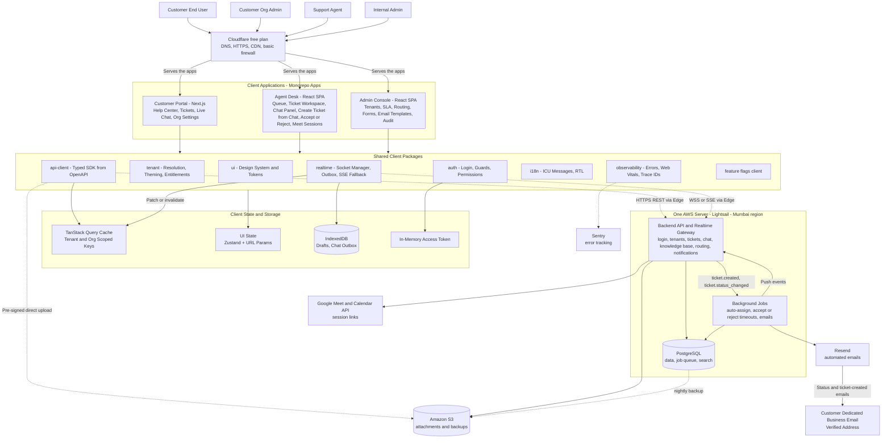
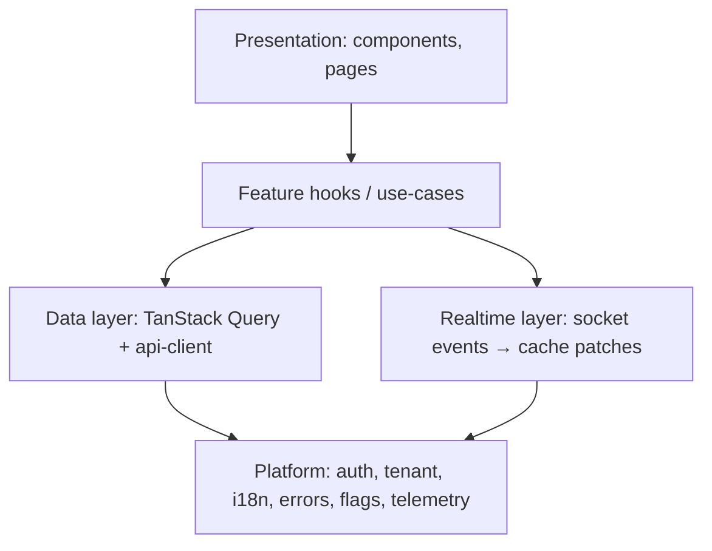
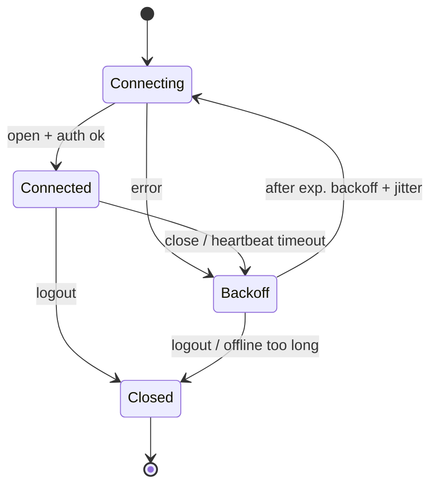
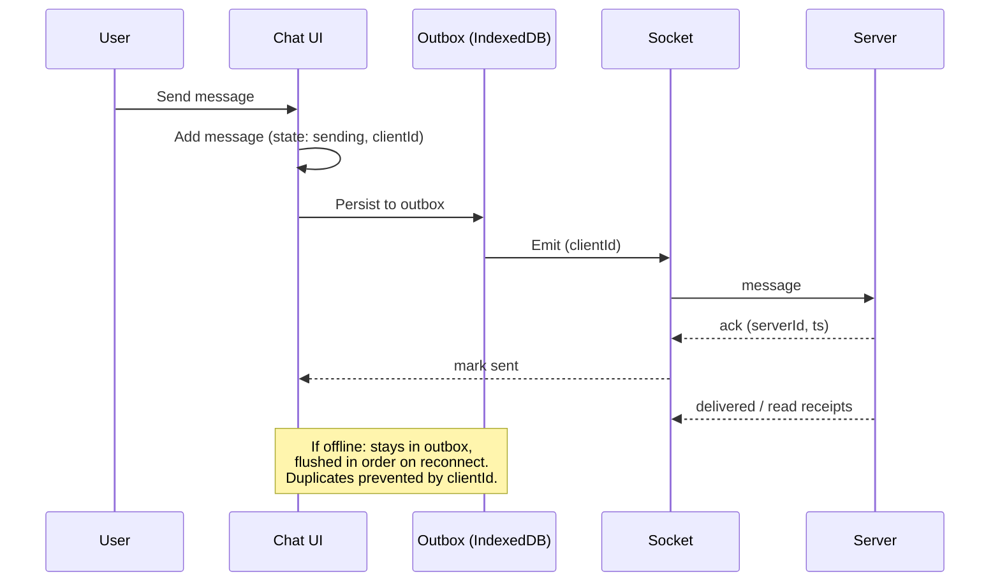
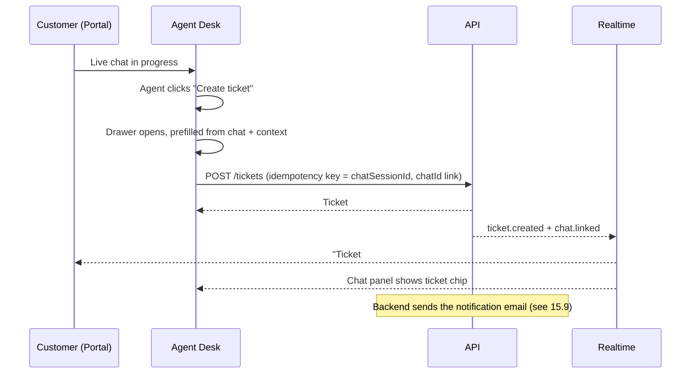

# Client-Side Architecture: B2B Customer Support System

**Status:** Draft v1 · **Scope:** Everything that runs in the browser (customer portal, agent desk, admin console) and how it talks to the backend. It also covers the backend parts the browser depends on: ticket routing and assignment, Google Meet sessions, notification emails, and low-cost hosting.
**Out of scope:** Detailed backend service design and the data model (covered separately).

---

## 0. Plain-Language Overview

Read this first if you are not a developer. Technical words are explained in boxes marked **In plain words** and in the glossary (section 23).

**What this system is.** A help desk on the web for business customers. A customer company (called a *tenant*) reports problems, which are recorded as *tickets*, or chats with support. Support engineers (called *agents* in this document) solve them. Admins set the rules.

**The three apps**

| App | Who uses it | In one sentence |
|---|---|---|
| **Customer Portal** | Customers and their company admins | Read help articles, raise tickets, chat with support, follow progress |
| **Agent Desk** | Support engineers (agents) and team leads | Where tickets and chats are worked on |
| **Admin Console** | Internal admins | Where rules, deadlines (SLAs), email templates and users are set up |

**The life of a ticket**

1. **A customer reports a problem** through the portal (a ticket form or live chat), or an agent turns a chat into a ticket.
2. **A confirmation email** goes to the customer company's business email address (section 15.9).
3. **The system picks an engineer automatically** using rules such as location, who handled the customer before, and who is free. If it cannot, the ticket waits in an *Unassigned* list for a person to pick (section 14A).
4. **The engineer is alerted** and can **accept or reject** the ticket. A rejected or ignored ticket goes back to be assigned again.
5. **The engineer works on it:** replies to the customer, writes internal notes, and, for virtual support, starts a Google Meet video session (section 14B).
6. **The engineer updates the status** (for example *In Progress* to *Resolved*). Every status change sends an email to the customer company (sections 14C and 15.9).
7. **The ticket is closed.**

**Two ways to assign, one safety net.** Tickets can be assigned **automatically** or **manually**. Both are always available. If the automatic part breaks, a person with the right permission can still assign tickets by hand (section 14A.5 explains exactly what that does and does not cover).

**Two kinds of support.** *Virtual* support is given remotely (chat, ticket, video call). *Manual* support is assumed to mean on-site, in-person help. This meaning still needs to be confirmed (section 22).

**Built to be cheap at small scale.** Everything runs on one small AWS server plus a few free or low-cost services (section 18A).

---

## 1. Context and Assumptions

| Topic | Decision / Assumption |
|---|---|
| Customers | **B2B.** Customers are *organizations*; each has multiple end users (requesters, org admins). |
| Tenancy | **Multi-tenant.** The client must be tenant-aware (branding, SSO, data scoping). |
| Customer chat | Live chat is available **inside the customer portal**. There is no embeddable widget for other websites. |
| Scale (assumed) | **Small scale.** Planning assumption until real numbers exist: up to ~20 agents, ~500 concurrent customer sessions, ~50 concurrent chats. Revisit with real numbers. |
| Team (assumed) | 4–8 frontend engineers, TypeScript-comfortable. |
| Browsers | Last 2 versions of Chrome, Edge, Firefox, Safari (incl. iOS Safari). |
| Compliance | WCAG 2.2 AA, GDPR-style privacy, audit-friendly behavior. |
| Budget | Lowest cost that is still reliable. The budget counts **only third-party services and hosting**. Developer and build cost is excluded. See section 18A. |
| Hosting | AWS (the organization already has AWS). One small server. |
| Email provider | Resend. |
| Video sessions | Google Meet. |
| Support types | Two kinds: **virtual** (remote) and **manual**, assumed to mean on-site or in-person. The meaning of "manual" needs confirmation (section 22). |
| Ticket assignment | Both **automatic** and **manual**, so people can take over if automatic assignment fails. See section 14A. |

Assumptions marked "assumed" should be validated before implementation starts.

---

## 2. Design Principles

1. **Separate by audience, share by package.** Three apps, one design system, one API client.
2. **Server state is not client state.** Server data lives in a query cache; UI state stays small and local.
3. **Real-time is an enhancement of correctness, not a replacement.** Sockets push hints; the cache and API remain the source of truth.
4. **The UI is untrusted.** Every permission check in the client is for convenience; the backend enforces.
5. **Fail soft.** Bad networks, dropped sockets and partial outages must degrade gracefully, never lose user input.
6. **Budgets over opinions.** Performance, accessibility and bundle size are enforced in CI.
7. **Boundaries over cleverness.** Strict dependency direction keeps a multi-year codebase maintainable.
8. **Automatic first, human always possible.** Automation does the routine work, and a person can always step in and take over.
9. **Cheapest setup that is still safe.** Start small and keep the number of paid services low.

---

## 3. System Architecture

> **In plain words:** Think of the system as three websites for three groups of people (customers, agents, admins). All three talk to the same "back office": one server with a database, plus a few outside services for email, file storage, video calls and error tracking.



The files of the three apps are served from the same server, behind the Cloudflare free plan. At this size one server is enough, and the backend is one application made of separate modules (tickets, chat, routing, notifications) rather than many separate services.

### 3.1 Why three apps and not one

| App | Audience | Key traits | Rendering |
|---|---|---|---|
| **Portal** | Customer users and org admins | SEO for Help Center, branded per tenant, light usage | SSG/ISR for KB, SPA routes for tickets |
| **Agent Desk** | Support agents | All-day use, real-time, keyboard-driven, multi-ticket | SPA |
| **Admin Console** | Internal admins | Form-heavy, config, audit | SPA |

Different audiences have different performance, security and UX needs. Forcing them into one bundle penalizes everyone.

---

## 4. Repository and Package Structure

A **monorepo** (pnpm workspaces + Turborepo or Nx).

```
/apps
  /portal          Customer portal (Next.js)
  /agent-desk      Agent dashboard (Vite + React)
  /admin           Admin console (Vite + React)
/packages
  /ui              Design system: tokens, primitives, composed components
  /api-client      Typed SDK generated from OpenAPI (+ hand-written wrappers)
  /realtime        Socket manager, event typing, outbox
  /auth            OIDC client, token store, guards, permission helpers
  /tenant          Tenant resolution, theming, feature entitlements
  /i18n            Message catalogs, formatters, locale detection
  /observability   Logging, error reporting, web vitals, trace IDs
  /config          Env schema, feature flags client
  /eslint-config, /tsconfig, /test-utils
```

### 4.1 Dependency rules (enforced by lint, e.g. `eslint-plugin-boundaries` or Nx module boundaries)

```
apps → features → shared packages
features ↛ other features      (communicate via shared packages or events)
shared packages ↛ apps
ui ↛ api-client                (design system has no data knowledge)
```

### 4.2 Feature-based layout inside each app

```
/src
  /app            Providers, router, layout shell
  /features
    /tickets
      /components   (feature-specific UI)
      /hooks        (useTicketList, useCreateTicket)
      /api          (query keys, fetchers, mutations)
      /state        (local UI state, if any)
      /routes
      index.ts      (public surface of the feature)
    /chat
    /knowledge-base
    /organization
    /notifications
  /shared           App-local helpers
```

---

## 5. Technology Choices (with rationale)

| Concern | Choice | Reason |
|---|---|---|
| Language | TypeScript (strict) | Safety across a large surface |
| UI library | React 18+ | Ecosystem, hiring, shared across 3 apps |
| Portal framework | Next.js | SSG/ISR for KB SEO, tenant-aware middleware |
| SPAs build | Vite | Fast dev and builds |
| Server state | TanStack Query | Caching, retries, dedupe, invalidation |
| UI state | Zustand (small stores) + React context | Minimal boilerplate |
| Forms | React Hook Form + Zod | Schema shared with API types |
| Tables/lists | TanStack Table + TanStack Virtual | Large agent queues |
| Rich text | TipTap (ProseMirror) | Replies, canned responses, KB editing |
| Styling | Tailwind + CSS variables (tokens) | Tenant theming via variables |
| Primitives | Radix UI | Accessible behaviors |
| Real-time | Native WebSocket wrapper + SSE fallback | Full control of reconnect/outbox |
| Search UI | Backend index via API. **PostgreSQL full-text search** | Good keyword search at no extra cost. Typo tolerance can come from the pg_trgm extension |
| i18n | FormatJS (ICU messages) | Plurals, RTL, formatting |
| Testing | Vitest, Testing Library, Playwright, Storybook, MSW | Full pyramid |
| Observability | Sentry + Web Vitals + OpenTelemetry (browser) | Errors, perf, trace correlation |
| Flags | OpenFeature client. **Simple settings stored in the database** | No paid service needed at small scale |

### 5.1 Services around the client

| Concern | Choice | Notes |
|---|---|---|
| Hosting | **AWS Lightsail**, Mumbai region (ap-south-1) | One flat monthly price for the server, storage and data transfer. The simplest way to run one server |
| Database | **PostgreSQL** | On the same server |
| Job queue | **PostgreSQL-based** | Background tasks (auto-assign, emails, timeouts) wait in the database, so no separate queue service is needed |
| CDN, DNS, HTTPS | **Cloudflare free plan** | Free |
| File storage | **Amazon S3** | Attachments use pre-signed uploads, as in section 11.3. Backups are stored here too |
| Email | **Resend** | Has a free tier and paid plans. Check current limits on Resend's pricing page |
| Video sessions | **Google Meet**, through Google's APIs | See 14B |
| Error tracking | **Sentry** (free plan) | |
| Logins | **Built-in login** | See 8.1 |
| Backend language | **Not decided.** Suggestion: TypeScript on Node.js | Lets the frontend and backend share the same type definitions |

---

## 6. Layered Architecture Inside an App



- **Presentation** renders and handles interaction only.
- **Feature hooks** hold business logic (`useReplyToTicket`: optimistic update, error mapping, analytics).
- **Data layer** owns fetching, caching, retries, query keys.
- **Realtime layer** translates socket events into cache updates.
- **Platform** is cross-cutting and injected via providers.

---

## 7. Multi-Tenancy on the Client (B2B-specific)

> **In plain words:** A *tenant* is one customer company using the system. Everything that company sees (branding, tickets, users) must stay separate from every other tenant. This section explains how the browser keeps them apart. For example, agents always see which company they are working for, so they do not reply in the wrong place.

### 7.1 Tenant resolution

Order of precedence:
1. Subdomain (`acme.support.example.com`) or custom domain (`help.acme.com`)
2. Claim in the access token (for agents, who span tenants)

Resolved once at app boot into a `TenantContext` containing: `tenantId`, branding tokens, enabled features/entitlements, SSO config, locale defaults.

### 7.2 Theming

- Brand colors, logo, fonts and radii are delivered as **design tokens** (JSON) and applied as CSS variables on `:root`.
- Contrast is validated: if a tenant color fails WCAG AA against its background, fall back to an accessible variant and warn in the admin console.

### 7.3 Organization model for customer users

- A customer user belongs to one or more **organizations**; roles per org (`requester`, `org_admin`, `viewer`).
- Org admins see all tickets of their org, manage users, view SLA/reporting. Requesters see own (or shared) tickets.
- The UI exposes an **org switcher** only when the user belongs to multiple orgs; the active org is part of every query key so caches never leak across orgs.

### 7.4 Agent cross-tenant safety

- The agent desk always shows the **active tenant** prominently (badge + color accent) to avoid replying in the wrong context.
- Query keys include `tenantId`; switching tenant clears tenant-scoped caches.
- Cross-tenant search is a distinct, clearly labeled mode.

---

## 8. Authentication and Authorization

> **In plain words:** *Authentication* means proving who you are (logging in). *Authorization* means what you are allowed to do. The browser hides buttons you are not allowed to use, but the server always checks again. Hiding a button is only a convenience, never the real protection.

### 8.1 Flows

| App | Method |
|---|---|
| Portal (customers) | OIDC Authorization Code + PKCE; **per-tenant SSO (SAML/OIDC)** where configured; magic link/email+MFA fallback |
| Agent / Admin | Corporate SSO + MFA, short sessions, step-up for sensitive actions |

**Launch default (proposed):** to keep cost low, sign-in uses the built-in login, with MFA (a second step such as a code from an authenticator app) for agents and admins. Single sign-on (SSO) with a company identity provider is added only when it is needed. Whether SSO is needed from day one is an open question (section 22).

### 8.2 Token handling

- Access token: **memory only**, short-lived (5–15 min).
- Refresh token: **HttpOnly, Secure, SameSite cookie**, rotated on use, handled by the BFF.
- Silent refresh via single-flight: concurrent 401s trigger **one** refresh, others wait.
- On refresh failure: preserve unsent drafts locally, redirect to sign-in with a return URL.
- Cross-tab sync with `BroadcastChannel` (logout in one tab logs out all).

### 8.3 Authorization in the UI

- Permissions arrive as a list of capabilities (`ticket:assign`, `ticket:claim`, `routing:manage`, `session:start`, `org:manage_users`), not only roles.
- `<Can permission="ticket:assign">` and `useCan()` gate UI; route guards gate navigation.
- The backend remains authoritative; a 403 is handled gracefully (friendly message, refresh permissions).

---

## 9. Data Fetching, Caching and State

### 9.1 Query key convention

```ts
['tenant', tenantId, 'org', orgId, 'tickets', 'list', { status, page }]
['tenant', tenantId, 'tickets', 'detail', ticketId]
```

Always includes tenant (and org when relevant). One factory function per feature produces keys; no inline strings.

### 9.2 Rules

| Case | Strategy |
|---|---|
| Lists | Cursor pagination; infinite scroll with virtualization in agent queues |
| Detail pages | Prefetch on hover/focus of list rows |
| Mutations (status, assign, reply) | Optimistic update + rollback + toast |
| Stale data | `staleTime` per resource (queues: seconds; KB: minutes; org settings: longer) |
| Retries | Network and 5xx only, backoff; never retry non-idempotent calls without an idempotency key |
| Pagination consistency | Cursor-based so live inserts don't shift pages |

### 9.3 Idempotency

Every create/reply mutation sends a client-generated `Idempotency-Key` (UUID). Double clicks and retries after timeouts never create duplicates.

### 9.4 Where state lives

| State | Location |
|---|---|
| Server data | TanStack Query cache |
| URL-addressable (filters, sort, selected ticket) | **URL** (search params), so views are shareable and refresh-safe |
| Ephemeral UI (open modal, panel sizes) | Component state / small Zustand store |
| Drafts | IndexedDB (autosaved), keyed by ticket + user |
| Preferences (theme, density, shortcuts) | Server-synced user settings + local cache |

---

## 10. Real-Time Architecture

> **In plain words:** "Real-time" means screens update by themselves, with no refreshing. The server pushes a small message ("new reply", "ticket assigned to you") through a connection that stays open (a *WebSocket*). If the connection drops, the app reconnects and asks for anything it missed.

### 10.1 Transport

- **WebSocket** primary, **SSE** fallback, **long-polling** last resort (corporate proxies in B2B environments often block sockets, so the fallback is a real requirement).
- One multiplexed connection per tab. For the agent desk, a **SharedWorker** (or leader-election via BroadcastChannel) keeps a single socket across tabs.

### 10.2 Connection manager



- Heartbeat (ping/pong) to detect half-open connections.
- Exponential backoff with jitter (1s → 30s cap).
- Pause when offline (`navigator.onLine` plus the `online` event) and when the tab is hidden for long periods.
- On reconnect: resubscribe to channels, then **request missed events since `lastEventId`**.

### 10.3 Event handling

Events are typed and versioned (`{ type, version, tenantId, entityId, seq, payload }`).

| Event | Client action |
|---|---|
| `ticket.updated` | Patch the cache entry; if unknown shape, invalidate |
| `ticket.assigned` | Update queue lists, notify the assignee |
| `chat.message` | Append to chat store, update unread counters |
| `chat.typing` | Ephemeral state, auto-expire after ~4 s |
| `presence.changed` | Update agent availability indicators |
| `sla.breach_warning` | Highlight the ticket, raise an alert |
| `ticket.assigned` (state: pending acceptance) | Show the ticket in the assignee's **Pending acceptance** list with Accept and Reject buttons and a countdown |
| `ticket.assignment_rejected` | Remove it from that agent's list, update the ticket timeline |
| `ticket.routing_failed` | Flag the ticket "Routing failed" in the Unassigned queue and alert team leads |
| `session.created` | Show the Meet link in the ticket or chat and notify the customer |
| `session.ended` | Update the ticket timeline |

Events are **hints**: if sequence gaps are detected (`seq` jump), the client refetches the affected resource.

### 10.4 Chat message lifecycle (client-side)



States: `sending → sent → delivered → read`, or `failed` with a retry control.

---

## 11. Customer Portal

### 11.1 Rendering strategy

| Route | Strategy | Why |
|---|---|---|
| `/help`, `/help/articles/:slug` | **SSG + ISR**, revalidated on publish webhook | SEO, speed, CDN cache |
| `/help/search` | Client-side with server search API | Dynamic |
| `/tickets/**`, `/org/**` | Auth-gated SPA routes | Private data |
| `/status` (optional) | SSR with short cache | Fresh |

Tenant-specific help centers: per-tenant static generation keyed by hostname (middleware rewrites to `/_tenants/[tenant]/...`).

### 11.2 Core user journeys

1. **Self-serve:** search KB → article → "Did this help?" → resolved, or "Contact support."
2. **Ticket creation with deflection:** as the subject is typed (debounced), suggest articles; user can still submit.
3. **Ticket tracking:** list with status, filters, org-wide view for org admins, thread view with attachments.
4. **Org admin:** manage users, view org tickets, SLA summary, export.

### 11.3 Ticket creation form

- Multi-step, schema-driven form (fields vary per tenant/category, defined by server-delivered **form schema**, rendered by a generic field renderer).
- Zod validation generated from the same schema.
- Draft autosave; recover after refresh or session expiry.
- Attachments: pre-signed direct upload to object storage with progress, cancel and retry; type/size checks client-side (re-validated server-side); optional virus-scan status shown ("Scanning…" → "Ready").

---

## 12. Live Chat in the Customer Portal

> **In plain words:** Customers chat with support inside the portal, after they sign in. There is nothing to install on any other website.

### 12.1 What the customer sees

- A **Chat** button in the portal opens a chat panel.
- **Before the chat starts,** the customer can search the help articles. Many questions are answered this way (this is called *deflection*). If that does not help, they start a chat or fill in the ticket form.
- **Outside business hours, or when no agent is available,** the panel shows the ticket form instead of chat.
- An **unread badge** and an optional sound tell the customer about new messages.
- The conversation **continues as the customer moves between portal pages.**
- On a phone the chat opens full screen, and it respects the "reduce motion" setting.

### 12.2 How it works

- Chat messages use the real-time connection and the outbox described in section 10, so a message typed during a short network drop is sent when the connection returns.
- Because the customer is signed in, the chat already knows their organization and tenant.
- An agent can turn the chat into a ticket (section 13.5), and the ticket then follows the assignment and status rules in 14A and 14C.
- An agent can start a Google Meet session from the chat (section 14B).

## 13. Agent Desk

> **In plain words:** The Agent Desk is the workspace where support engineers spend their day. It shows a list of tickets (the *queue*), the conversation with the customer, and the customer's details side by side.

### 13.1 Layout

Three-pane workspace: **Queue / views** → **Conversation + ticket thread** → **Context panel** (customer, org, SLA, related tickets, KB suggestions, internal notes). Multiple open tickets as tabs; panels resizable, state persisted.

### 13.2 Productivity features (high value for agents)

- Command palette (Cmd/Ctrl+K) and **keyboard shortcuts** for assign, reply, macro, next ticket.
- Canned responses/macros with variables (`{{customer.name}}`), searchable.
- Saved views and filters stored in URL + server.
- Bulk actions with undo.
- Collision detection: "Priya is also viewing/typing" (presence on ticket).
- Internal notes vs public replies with **clear visual distinction** and a confirm on ambiguous sends.
- Side conversations and @mentions to colleagues.
- Draft autosave per ticket.

### 13.3 Performance

- Virtualized queue (thousands of rows).
- Prefetch the next ticket in queue.
- Single socket across tabs (SharedWorker / leader election).
- Pause expensive subscriptions for background tabs.

### 13.4 Safety

- Active tenant badge always visible.
- Confirmation for high-risk actions (merge, delete, bulk close).
- Sensitive data masking (e.g. card numbers) with reveal-on-demand, audited server-side.

### 13.5 Creating a ticket from a live chat

An agent can raise a ticket at any point during (or after) a live chat, without retyping anything.

**Entry points**
- A persistent **"Create ticket"** button in the chat panel header, plus a keyboard shortcut and a command-palette action.
- A **"Convert to ticket"** option on a single message or selection (start the ticket from the problem statement).
- **Automatic prompts:** when a chat ends unresolved, or a customer leaves or no agent is available (missed chat), the desk offers one-click ticket creation; tenants can configure auto-creation in the admin console.

**What the form does**
- Opens as a side drawer so the chat stays visible.
- **Prefilled:** requester, organization, tenant, subject (suggested from the first customer message), description (summary or transcript excerpt), category, priority, plus the portal page the customer was on and their plan.
- Full transcript is attached as a read-only linked conversation, not pasted text.
- Agent can set assignee (default: self), status, tags and internal notes before saving.

**Linking behavior**
- The chat shows a **ticket reference chip** (e.g. `#12345`) once created; the ticket shows a "Created from chat" badge with a link back to the transcript.
- Later chat messages on the same session keep syncing to the ticket thread (a single conversation, not two copies).
- If a ticket already exists for this chat, the button changes to "Open ticket #12345", which prevents duplicates.
- Creation sends an **idempotency key** tied to the chat session ID, so double clicks or retries can't create two tickets.

**Customer side**
- The customer sees a message in the chat such as "We've opened ticket #12345 for you" with a link to the portal, and the same reference arrives by email (see 15.9).
- The ticket is created for the signed-in customer's organization, and the confirmation email goes to the organization's verified business email (see 15.9).



### 13.6 Assignment inbox and unassigned queue

The Agent Desk includes (details in section 14A):
- A **Pending acceptance** list: tickets automatically assigned to you that you must accept or reject, each with a countdown.
- An **Unassigned** queue: tickets nobody owns yet. Anyone with the `ticket:claim` capability can take one, and anyone with `ticket:assign` can give one to someone else.
- Assign, reassign and claim actions in the ticket header, the command palette and keyboard shortcuts.
- A ticket timeline that shows every assignment event (automatic or manual, who, rejections and reasons).

### 13.7 Status changes and sessions

- The assigned agent changes the ticket status here (section 14C). The status dialog shows which customer email will be notified (section 15.9).
- A **Start Meet session** button appears on tickets and chats for agents with `session:start` (section 14B).

---

## 14. Admin Console

> **In plain words:** The Admin Console is the control room. Admins set the rules that the rest of the system follows: deadlines (SLAs), assignment rules, forms, email templates and users. Changes follow **draft, preview, publish**, so a half-finished rule never goes live by accident.

- Config domains: tenants and branding, SLAs, routing/assignment rules, business hours, canned responses, forms and fields, integrations/webhooks, users/roles, audit log.
- **Schema-driven forms** for rule builders and form designers; JSON-schema backed validation.
- **Draft → preview → publish** workflow for rules and SLAs with a diff view and rollback.
- Audit log viewer with filters and export.
- Every change shows who/when; destructive operations require typed confirmation.
- **Routing settings:** the rule builder for automatic assignment, the on/off switch for auto-assign per tenant, accept or reject timeout, rejection limit and the "unassigned too long" alert time (section 14A.6).
- **Session settings:** a per-tenant switch for Google Meet sessions and the status of the Google connection (section 14B).
- **Email templates:** the ticket-created email and the agent assignment email are editable per tenant, in addition to the status-change email (section 15.9).
- **Health warnings:** routing failures and email bounces show as alerts in the console.

---

## 14A. Ticket Routing and Assignment

> **In plain words:** "Routing" means deciding who handles a new ticket. The system can decide automatically (**auto-assign**) using rules, or a person can choose (**manual assign**). Both are always available. The automatic part runs as its own background job, so if it breaks, people can still assign tickets by hand.

**Goal:** every ticket gets an owner quickly and automatically, and a person can always step in.

### 14A.1 Two modes, always available

| Mode | Who or what assigns | When it is used |
|---|---|---|
| **Auto-assign** | The routing engine on the backend | Default for every new ticket |
| **Manual assign** | An agent or lead with `ticket:assign` (or `ticket:claim` to take one for themselves) | Any time, and when auto-assign fails or finds nobody |

Each tenant has an **auto-assign switch** in the Admin Console:
- **On:** the routing engine runs for every new or reopened ticket.
- **Off:** tickets go straight to the Unassigned queue for manual pickup.

Both modes use the same assignment action, the same `ticket.assigned` event and the same audit trail.

### 14A.2 Support type: virtual or on-site

Each ticket carries a **support type**:
- **Virtual:** handled remotely through chat, replies and, if needed, a Google Meet session (section 14B).
- **On-site (assumed meaning of "manual" support):** an engineer needs to visit in person. This meaning needs confirmation (section 22).

Support type can be used as a condition in routing rules. For example, on-site tickets are matched to an engineer in the customer's city, while virtual tickets can go to any available engineer.

### 14A.3 How auto-assign decides

The routing engine runs on the backend (not in the browser) when a ticket is created or reopened, so it works even if no agent has a screen open.

| Step | What happens |
|---|---|
| 1. Narrow the pool | The admin rules decide which agents are allowed: for example by team, skill, language, category, priority, tenant and support type |
| 2. Remove ineligible agents | An agent is **eligible** only if they are online or inside their working hours, below their maximum number of open tickets, and not on leave |
| 3. Prefer the previous handler | If the engineer who last handled this customer or organization is in the pool and eligible, pick them |
| 4. Else prefer the same location | Pick an eligible engineer in the same city or region as the customer (for example a Bangalore ticket goes to a Bangalore engineer) |
| 5. Tie-break | If several remain, choose by a configured strategy: least loaded, round-robin or skill-based (the strategy is an open question, section 22) |
| 6. Nobody found | The ticket goes to the **Unassigned queue** |

**Example:** An on-site Technical ticket arrives from a customer in Bangalore. The pool is the Technical team's on-site engineers. Engineer A, who handled this customer before and works in Bangalore, is online and under their ticket limit, so Engineer A is chosen and the ticket enters *Pending acceptance*.

Whether the previous handler outranks the same-location engineer (steps 3 and 4) is an open question (section 22).

**Data needed that does not exist yet**
- On the customer organization or ticket: city or region.
- On each agent profile: location, skills, working hours, maximum open tickets, leave status.

### 14A.4 Accept or reject

Assignment has its own state, separate from ticket status (section 14C):

| Assignment state | Meaning |
|---|---|
| **Unassigned** | Nobody owns the ticket yet |
| **Pending acceptance** | Auto-assigned. The engineer has been alerted and must accept or reject |
| **Accepted** | The engineer owns the ticket and work can start |

How it works:
- **Accept:** the ticket becomes *Accepted* and work starts.
- **Reject:** the engineer must give a reason. The ticket goes back to routing, and the same agent is skipped for that ticket.
- **No response** within the timeout (configurable, for example 10 to 15 minutes): treated as a reject, and the ticket is routed again.
- **Too many rejections or timeouts** (configurable limit): the ticket goes to the Unassigned queue and a lead is alerted. This stops a ticket bouncing around forever.
- **The SLA clock keeps running** during acceptance and re-routing, so rejecting does not buy extra time.
- **Manual assignments:** whether the engineer must also accept is a per-tenant setting (open question, section 22).

### 14A.5 Manual assignment and failover

- Anyone with `ticket:assign` can assign, reassign or hand over a ticket. Anyone with `ticket:claim` can take an unassigned ticket.
- Reassigning needs a short reason, and the ticket history is kept.

**What happens when something breaks**

| Situation | What happens |
|---|---|
| The automatic routing job crashes or errors | The ticket is still created. It lands in the Unassigned queue, flagged **Routing failed**. Team leads are alerted, the Admin Console shows a routing-health warning, and people assign by hand. When routing recovers, flagged tickets can be re-run in bulk |
| No rule matches or nobody is eligible | The ticket goes to the Unassigned queue |
| The engineer rejects or does not answer | The ticket is routed again. After the rejection limit it goes to the Unassigned queue and a lead is alerted |
| A ticket stays unassigned too long (configurable, for example 10 minutes) | A lead is alerted, so no ticket sits unnoticed |
| **The whole server is down** | **Nobody can assign, not even by hand,** because manual assignment uses the same server and database. The protections are an uptime alert, nightly backups and a documented restore procedure |

The fallback therefore covers a failure of the **automatic routing part**, not a failure of the whole system.

### 14A.6 Admin Console settings

- Routing rules use the same **draft, preview, publish** flow as other rules, with a diff view and rollback (section 14).
- Admins can test a rule against a sample ticket before publishing.
- Settings: the auto-assign switch, accept or reject timeout, rejection limit, unassigned-too-long alert time and the tie-break strategy.

### 14A.7 Events and audit

| Event | Effect |
|---|---|
| `ticket.assigned` (with state pending acceptance or accepted) | Updates queues and alerts the assignee |
| `ticket.assignment_rejected` | Routes again, and alerts a lead after the limit |
| `ticket.routing_failed` | Flags the ticket and alerts leads |

Every assignment, rejection, timeout and manual override is audit-logged with who or what did it, when and why.

---

## 14B. Virtual Support Sessions (Google Meet)

> **In plain words:** For virtual support, an agent can start a video call with the customer without leaving the ticket. The system creates a Google Meet link and posts it into the conversation. The customer clicks **Join session**. The call itself happens in Google Meet.

**Goal:** an agent can start a video or screen-sharing session from a ticket or chat in the Agent Desk.

### 14B.1 Flow

1. The agent clicks **Start Meet session** on a ticket or chat. This needs the `session:start` capability.
2. The backend creates the Meet link through Google's APIs. The browser never holds Google credentials.
3. The link is posted into the ticket thread or chat, and the customer is notified. In the Portal it appears as a **Join session** button.
4. The call runs in Google Meet (a new tab or the Meet app).
5. The agent marks the session ended and can add a short summary note. The session is saved on the ticket timeline.

### 14B.2 Instant and scheduled sessions

| Type | Use |
|---|---|
| **Instant** | The customer is in a chat now and needs help immediately |
| **Scheduled** | The agent proposes a time and the customer receives an invitation with the Meet link |

### 14B.3 Where it appears

| App | What it shows |
|---|---|
| **Agent Desk** | Start Meet session button, session status, link, end and add-note controls |
| **Portal** | Join session button on the ticket and in the chat, plus session history |
| **Admin Console** | Per-tenant switch for Meet sessions and the Google connection status |
| **Ticket timeline** | One entry per session: created, joined, ended, with duration and agent |

### 14B.4 Rules

- **Consent:** the customer chooses to join, and screen sharing is their choice inside Meet.
- **Audit:** every session records who started it, the ticket, the time and the duration.
- **Recording:** off by default. If a tenant enables it, it needs explicit customer consent and follows the privacy rules in section 15.7.
- **Links stay private:** the Meet link is shared only in the ticket or chat, never in public pages. The status-change emails do not include it.
- **Permissions:** the backend enforces `session:start`. The button check in the browser is only a convenience (design principle 4).
- **Failure:** if Google cannot be reached, the button shows a clear error and the agent continues in chat. The ticket is not blocked.
- **Status:** ending a session does not change the ticket status automatically. The agent does that (section 14C).

### 14B.5 What Meet does not do

Google Meet gives video, audio and screen sharing. As far as we know it does not let the agent take control of the customer's computer (to be verified before build). Remote control is out of scope for v1.

### 14B.6 Setup to confirm before building

The backend can create links through Google's Meet API or through Google Calendar events that include a Meet link. The exact choice depends on how the Google account is set up, which is an open question (section 22):
- One shared support account, or each agent's own account?
- Is a paid Google Workspace plan required, and what does it cost?
- Quotas and licensing should be checked in Google's current documentation.

---

## 14C. Ticket Status Workflow

> **In plain words:** A ticket moves through stages, called *statuses*. Mostly the engineer who owns the ticket moves it forward. Every change sends an email to the customer company and appears on the ticket timeline.

### 14C.1 Who can change status

| Who or what | How | Notes |
|---|---|---|
| **The assigned agent** | Changes status in the Agent Desk ticket workspace | The normal path |
| **Automation** | Backend rules | For example closing a ticket after a period of no customer reply. The email and the timeline show "Automation" as the actor |
| **SLA rules** | The system changes or escalates a ticket when a deadline timer triggers | |
| **API** | An integration updates the ticket | |

Admins do not change statuses in the Admin Console (it is for configuration). An admin who also has an agent role can do it from the Agent Desk. Whether customers can close or reopen tickets is an open question (section 22).

### 14C.2 Proposed statuses (to confirm)

The status list below is a proposal:

| Status | Meaning |
|---|---|
| **New** | Created, not yet being worked on |
| **In Progress** | The engineer is working on it |
| **Waiting on Customer** | The engineer needs information from the customer |
| **Resolved** | The engineer believes the problem is fixed |
| **Closed** | Finished. No more replies expected |

Assignment (section 14A.4) is tracked separately from status, so a ticket can be *New* and *Pending acceptance* at the same time.

### 14C.3 What a status change triggers

Every status change, from any source, raises the `ticket.status_changed` event. The backend then sends the customer email (section 15.9), updates the ticket timeline and pushes the update live to open screens. The allowed moves between statuses (for example whether *Closed* can go back to *In Progress*) are an open question (section 22).

---

## 15. Cross-Cutting Concerns

### 15.1 Error handling

- Error boundaries at app, route and panel levels.
- Normalized error shape: `{ code, message, traceId, details }`; the UI shows a human message plus a copyable **reference ID** for support.
- Differentiated handling: validation (inline), auth (re-login flow), permission (403 view), not found, network (retry banner), server (generic + trace ID).

### 15.2 Offline and resilience

- Offline banner; reads served from cache where safe.
- Mutations: queued only for safe/idempotent operations (chat messages, drafts); others fail with a clear retry option.
- Service worker (portal and agent desk) for asset caching; **no** caching of authenticated API responses at the SW level.

### 15.3 Security

| Risk | Mitigation |
|---|---|
| XSS (chat, ticket HTML, KB) | Sanitize with DOMPurify using an allowlist; render rich text through a controlled renderer; avoid `dangerouslySetInnerHTML` on raw data |
| Clickjacking | `frame-ancestors` set so other websites cannot embed the apps |
| CSRF | SameSite cookies + CSRF token on cookie-authenticated calls |
| Token theft | No tokens in localStorage; short-lived access tokens |
| Malicious uploads | Type/size checks, server-side scanning, download via `Content-Disposition: attachment`, no inline rendering of untrusted HTML/SVG |
| Supply chain | Lockfile, `pnpm audit`/Renovate, SRI for third-party scripts, minimal dependencies |
| CSP | Strict CSP with nonces; report-only first, then enforce |
| Open redirects | Allowlist for return URLs |
| Link safety | `rel="noopener noreferrer"` on user-supplied links; warn on external links |

### 15.4 Accessibility (WCAG 2.2 AA)

- Radix/React Aria primitives; focus management on modals, route changes and new chat messages.
- `aria-live` regions for incoming messages (polite) and SLA alerts (assertive).
- Full keyboard operability including the chat panel and the command palette.
- Color contrast validated, including **per-tenant themes**.
- Automated (axe in CI + Storybook a11y) plus manual screen-reader passes before release.

### 15.5 Internationalization

- ICU messages; no string concatenation.
- Locale detection order: user setting → tenant default → browser.
- RTL support via logical CSS properties.
- Dates, numbers, time zones formatted per locale; agents see the **customer's local time** in context.
- KB content localization with fallback to default language and a "translated from…" indicator.

### 15.6 Observability

- Error reporting with release tags, tenant and user ID hash (no PII in payloads).
- Web Vitals (LCP, INP, CLS) segmented by app and route.
- A **trace ID** generated per request (W3C `traceparent`), echoed in error UIs and correlated with backend traces.
- Product analytics events through a thin abstraction (vendor-swappable), consent-aware.

### 15.7 Privacy

- Consent banner and analytics gating in the portal where required.
- PII redaction in logs and session replay (replay disabled by default in the agent desk).
- Data export and deletion requests surfaced in the portal for org admins.

### 15.8 Feature flags and entitlements

- Flags for rollout (percentage, tenant, role); entitlements for plan-based features (e.g. chat only on enterprise plan). Both evaluated through the `tenant` package; UI hides, backend enforces.

### 15.9 Notifications and status-change emails

**Requirement:** when a ticket's status changes, an automated email goes to the customer organization's dedicated business email address.

**Ownership of responsibility**
- The **email is sent by the backend** (Notification Service), triggered by the `ticket.status_changed` event. The client never sends the email, because it must fire no matter who changed the status (agent, automation, API, SLA rule) and even if no browser is open.
- The client's job is to **configure it, show it, and make it trustworthy.**

**Client responsibilities**

| Where | What the client provides |
|---|---|
| **Portal: org settings (org admin)** | Set one or more **dedicated business email addresses** for the organization (e.g. `support@acme.com`), choose which status changes trigger an email, and send a test email. |
| **Verification** | A new address starts as "Pending"; the admin must click the confirmation link sent to it before it receives notifications. The UI shows Verified / Pending / Bounced states. |
| **Admin console (internal)** | Per-tenant templates (branded, localized, with variables like `{{ticket.id}}`, `{{old_status}}`, `{{new_status}}`, `{{portal_link}}`), default triggers, sender identity/domain status (SPF/DKIM), and template preview before publish. |
| **Agent desk** | Status change dialog shows **"A notification email will be sent to acme@..."** with an option to suppress or add a note when policy allows. Ticket timeline shows each email as an event (Sent / Delivered / Bounced / Failed). |
| **Portal ticket view** | Notification history for the ticket, and a link in every email that deep-links to the ticket (auth required). |
| **User preferences** | Individual users can set their own notification channels (email, in-app); org-level business address rules are separate from personal preferences. |

**Email content (template contract)**
- Subject: `[#12345] Status changed: In Progress → Resolved`.
- Body: ticket title, old and new status, who or what changed it (agent name or "Automation"), latest public reply (if any), link to the portal.
- Internal notes and agent-only data are **never** included.
- Localized to the organization's language; plain-text and HTML versions.

**Failure and trust behavior**
- Bounce/failure → visible warning to the org admin in the portal and an internal alert in the admin console.
- Dedupe: rapid consecutive status changes can be **batched within a short window** (configurable) to avoid email floods.
- Every email send is auditable (timestamp, recipient, template version).

**Related notification surfaces (same pipeline)**
- In-app notifications and unread badges via the realtime channel.
- Optional webhooks and SMS where entitled by the tenant plan.

**Email provider:** emails are sent through **Resend**. The Notification Service is the only code that talks to the provider. The sending domain must be verified with SPF and DKIM (DNS records that prove the emails really come from your domain). The Admin Console shows this verification status.

### 15.9.1 Emails and alerts when a ticket is created

> **In plain words:** When a ticket is created, the customer company gets a "we received your request" email, and the assigned engineer gets an alert with the basic ticket details.

**To the customer company**
- When: on the `ticket.created` event, sent by the backend to the organization's verified business email.
- Subject example: `[#12345] We received your request`.
- Body: ticket ID, title, current status (*New*) and a link to the ticket in the portal. Same rules as status emails: never any internal notes or agent-only data, localized, plain-text and HTML versions.
- Tenants can switch this email on or off and edit the template in the Admin Console.

**To the assigned engineer**
- **In-app alert** (always on): through the real-time channel, with an unread badge in the Agent Desk (the `ticket.assigned` event, section 10.3).
- **Email** (each agent can turn it on or off in their own preferences): ticket ID, title, priority, customer and organization, support type, and a link that opens the ticket in the Agent Desk.
- The email does **not** contain the full ticket text or attachments, because email is not a secure channel and the content may be sensitive. The engineer opens the link to read it.
- While the assignment is *Pending acceptance*, the alert says the ticket needs accepting and shows the deadline.

**Failure behavior:** the same as for status emails. Bounces and failures show as warnings, and every send is audited.

---

## 16. Performance Strategy

| Area | Tactic |
|---|---|
| Bundles | Route-level code splitting; dynamic import for editors, charts, command palette; bundle analyzer in CI |
| Rendering | Virtualization; memoization only where profiled; avoid global re-render via selector-based stores |
| Network | HTTP/2/3, CDN, prefetch on intent, request dedupe, compression (Brotli) |
| Images/assets | Responsive images, lazy loading, modern formats |
| Fonts | Subset, `font-display: swap`, self-hosted |
| Third-party | Loaded after interaction/idle, isolated where possible |

**Budgets (enforced by Lighthouse CI / size-limit):**

| App | LCP | INP | CLS | Initial JS (gzip) |
|---|---|---|---|---|
| Portal (KB pages) | < 2.0 s | < 200 ms | < 0.1 | < 120 KB |
| Portal (app routes) | < 2.5 s | < 200 ms | < 0.1 | < 200 KB |
| Agent Desk | < 3.0 s (warm < 1.5 s) | < 150 ms | < 0.1 | < 350 KB (split) |

---

## 17. Testing Strategy

| Layer | Tooling | Focus |
|---|---|---|
| Unit | Vitest | Utilities, reducers, schema validation, connection manager |
| Component | Testing Library + Storybook | States (loading/empty/error), accessibility |
| Contract | OpenAPI-generated types, MSW handlers, Pact (optional) | API drift detection |
| Integration | Vitest + MSW | Feature flows with mocked network |
| E2E | Playwright | Critical paths per app; cross-browser |
| Real-time | Custom fake socket server | Reconnect, duplicate, out-of-order, gap-fill scenarios |
| Visual | Storybook + Chromatic/Playwright snapshots | Design system regression, tenant themes |
| A11y | axe-core in CI, manual SR checks | WCAG regressions |
| Performance | Lighthouse CI, bundle-size limits | Budget enforcement |
| Resilience | Playwright with throttling/offline | Slow 3G, dropped sockets, token expiry mid-action |

**Critical E2E paths:** sign in (SSO), search KB → deflect, create ticket with attachment, agent receives and replies, customer sees the reply in real time, chat reconnect after network loss, org admin invites a user, customer chat in the portal, ticket auto-assigned → agent accepts, agent rejects → ticket re-routed, routing failure → manual assignment from the Unassigned queue, agent starts a Meet session → customer joins, ticket-created and status-change emails sent.

---

## 18. Build, Delivery and Environments

- **CI:** typecheck, lint (incl. boundary rules), unit/integration tests, build, size and a11y checks, preview deployment per PR.
- **CD:** the portal runs as a Node app on the server (so help pages can be regenerated), and the two SPAs are static files with immutable hashed filenames and `index.html` no-cache, served behind the CDN.
- **Config:** runtime config injected (not baked) so one build serves all environments.
- **Environments:** local → preview → staging → production, each with its own tenants and test data.

### 18A. Hosting and Cost (Small Scale)

> **In plain words:** The whole system runs on **one small AWS server**, with a few free or low-cost services around it. This section estimates the monthly bill. It **excludes developer and build cost**. All figures are rough estimates, not quotes. Check each vendor's current pricing page and the AWS Pricing Calculator for the Mumbai region before budgeting.

**Estimated monthly cost**

| Item | What is used | Estimate per month |
|---|---|---|
| Server (apps, backend, real-time chat, background jobs) | AWS Lightsail, around 2 GB RAM | about $12 to $25 |
| Database | PostgreSQL on the same server, or the Lightsail managed database | $0, or about $15 |
| CDN, DNS and HTTPS | Cloudflare free plan | $0 |
| Email | Resend (free tier, then paid plans) | $0 to about $20 |
| File storage | Amazon S3 | about $1 to $3 |
| Backups | Server snapshots plus a nightly database copy to S3 | about $1 to $3 |
| Error tracking and uptime alerts | Sentry free plan and a free uptime monitor | $0 |
| Google Meet | A Google account used by the backend. Depends on the account type (open question) | $0 to a few dollars per user |
| Domain name | Paid yearly, spread over the year | about $1 |
| **Total** | | **about $20 to $30** with the database on the same server, **about $35 to $45** with the managed database, and up to **about $75** if every paid item is used |

**Reference prices seen in 2026 sources (verify before use):** a small AWS server of this size costs about $12 per month on-demand in the us-east-1 region, and the smallest Lightsail managed database is about $15 per month. Mumbai region prices differ.

**Free credits:** AWS accounts created since July 2025 receive $100 to $200 in credits that last up to six months, rather than a 12-month free server. Older accounts keep the earlier 12-month free micro-instance offer. Which applies depends on when your AWS account was created.

**Cost safety:** set a billing alert (AWS Budgets) at about $50 per month so a mistake or a traffic spike cannot become a surprise bill.

**Single server risk:** with one server, a crash stops everything, including manual assignment (see 14A.5). Mitigations: nightly backups kept off the server (in S3), an uptime alert and a written restore procedure.

---

## 19. Key Decisions (ADR summary)

| # | Decision | Rationale | Trade-off |
|---|---|---|---|
| 1 | Three apps in a monorepo | Audience-specific performance and security; shared core | More build config |
| 2 | Next.js for the portal, Vite SPAs for the rest | SEO only where needed | Two runtime models |
| 3 | TanStack Query for server state | Mature caching and mutation patterns | Learning curve for cache patching |
| 4 | Tokens in memory + HttpOnly refresh cookie via BFF | Reduces XSS token theft | Needs a BFF layer |
| 5 | WebSocket + SSE fallback, outbox for chat | Corporate networks, reliability | More client complexity |
| 6 | Customer chat lives inside the portal, with no embeddable widget | Nothing to install on other sites, and one less app to build and secure | Customers cannot chat from their own websites |
| 7 | Server-driven form schemas | Per-tenant ticket forms without redeploys | Needs a robust renderer and validation parity |
| 8 | Tenant theming via CSS variables with contrast guards | Branding without per-tenant builds | Contrast edge cases |
| 9 | URL as the source of truth for view state | Shareable, refresh-safe, back-button friendly | Careful serialization |
| 10 | Contract-first API (OpenAPI → generated client) | Type safety, fewer integration bugs | Needs API discipline |
| 11 | Resend as the email provider | Simple, cheap, free tier to start | Check free-tier limits and deliverability as volume grows |
| 12 | Auto-assign and manual assign both available | A person can take over if automation fails | Two paths to build and test |
| 13 | Routing runs on the backend as a separate job | Works with no browser open, and can fail without taking manual assignment down | A little more backend work |
| 14 | Accept or reject with a timeout and a rejection limit | Engineers keep control and no ticket is stuck | More states and screens |
| 15 | Google Meet for virtual sessions | Customers already know it, and no video system to build | Depends on Google account setup and licensing. No remote control |
| 16 | One AWS server, with PostgreSQL doing queue and search | Lowest cost and fewest parts | Single point of failure |
| 17 | Built-in login, SSO only when needed | Avoids a paid identity service | Must be added when a customer requires SSO |

---

## 20. Phased Delivery Plan

| Phase | Scope | Exit criteria |
|---|---|---|
| **0. Foundations** (2–3 wks) | Monorepo, CI, design tokens + core UI kit, auth, tenant resolution, API client generation, observability baseline | A sample authenticated page per app deployed to preview |
| **1. Portal MVP** (4–6 wks) | KB (SSG + search), sign-in/SSO, ticket create (attachments), ticket list/detail, org admin basics | E2E critical paths green; perf budgets met |
| **2. Agent Desk core** (4–6 wks) | Queue, ticket workspace, reply/notes, **manual assignment and Unassigned queue**, **status workflow (14C)**, canned responses, shortcuts | Agents handle tickets end-to-end in staging, assigning by hand |
| **3. Real-time + Chat** (4–5 wks) | Socket layer, live updates, chat in portal and desk, presence, outbox | Reconnect/gap-fill tests green; load test at target concurrency |
| **3A. Routing and assignment** (est. 2–3 wks) | Auto-assign engine, Pending acceptance with accept or reject, timeouts, failover to the Unassigned queue, assignment alerts | Auto-assign, reject and re-route, and routing failure tests green |
| **4. Virtual sessions** (est. 1–2 wks) | Google Meet connection, Start Meet session, Join session in the portal, session log | Agent starts a session and the customer joins from the portal |
| **5. Admin Console** (3–5 wks) | Tenants/branding, SLAs, **routing rule builder and routing settings**, forms, **email templates**, audit log | Config changes reflected in the clients without redeploy |
| **6. Hardening** (2–3 wks) | A11y audit, security review/pen test, performance tuning, docs | Sign-off checklist complete |

Phase 3A depends on manual assignment (Phase 2) and the realtime layer (Phase 3). Until the full rule builder arrives in Phase 5, routing uses simple default settings. Phase 4 depends on chat and the ticket thread (Phase 3). The week estimates for 3A and 4 are estimates and should be validated.

---

## 21. Risks and Mitigations

| Risk | Impact | Mitigation |
|---|---|---|
| Corporate proxies block WebSockets | Chat unusable for some customers | SSE/long-poll fallback from day one; test in proxy-constrained environments |
| Tenant data leakage via cache | Severe | Tenant/org in every query key; clear caches on switch; automated tests for key factories |
| Tenant brand colors fail contrast | Accessibility and legal | Automated contrast checks with safe fallbacks |
| Real-time complexity underestimated | Delays and bugs | Fake socket server tests early; limit v1 to chat, ticket updates and presence |
| Bundle growth in the agent desk | Slow load | Budgets in CI, lazy-load heavy modules |
| Token/session edge cases | Lost work | Draft persistence, single-flight refresh, cross-tab sync, E2E for expiry mid-action |
| API drift | Runtime failures | OpenAPI codegen, contract tests in CI |
| One server is a single point of failure | Everything stops, including manual assignment | Nightly off-server backups, uptime alert, restore procedure (18A) |
| Automatic routing fails or misroutes | Tickets sit unowned | Separate routing job, Unassigned queue with "Routing failed" flag, lead alerts, manual assignment (14A.5) |
| Accept or reject loops | Tickets bounce between engineers and the SLA is missed | Rejection limit, SLA clock never pauses, lead alert, "unassigned too long" alert |
| Google Meet account or licensing is unclear | Sessions cannot be created, or unexpected cost | Decide the account model early (14B.6) and check Google's current terms |
| Email goes to spam or free-tier limits are hit | Customers miss updates | Verified SPF and DKIM, bounce warnings (15.9), monitor volume, move to a paid plan when needed |
| Cost surprise on AWS | Unexpected bill | Billing alert, no unused paid add-ons, review monthly (18A) |
| Customer location or agent profile data is missing | Location matching does not work | Required fields in organization and agent profiles, fall back to the Unassigned queue |

---

## 22. Open Questions (to validate before Phase 0)

1. Real numbers for agents, chats and tickets per day? (A small scale is assumed, section 1.)
2. Is SSO required per customer tenant from day one (SAML vs OIDC)?
3. Custom domains for tenant help centers in v1?
4. Languages and RTL needs at launch?
5. Is there an existing design system or brand to adopt?
6. Data residency requirements that affect client endpoints/regions?
7. Is a native mobile app planned (which would favor a shared API client and push notifications)?
8. Which analytics/RUM vendors are already approved?
9. Is the "dedicated business email" one address per organization, or can an org have several (e.g. per department or per ticket category)?
10. Should every status change trigger an email, or only selected ones (e.g. Resolved, Closed)? Should agents be able to suppress an email?
11. Should tickets be created automatically when a chat ends unresolved, or always by an agent's decision?
12. What exactly does **"manual" support** mean: on-site or in-person visits (assumed)? If so, how are visits scheduled and recorded?
13. Who is chosen inside a matching group: the least-loaded agent, round-robin, or skill-based?
14. Does the **previous handler** outrank the **same-location** engineer, or the reverse?
15. Where does a customer's location come from: the organization profile, the ticket form, or the IP address?
16. If nobody in the matching location is available, should the ticket go to another region or to the Unassigned queue?
17. What are the default accept or reject timeout and the maximum number of rejections?
18. Must manually assigned tickets also be accepted by the engineer?
19. Which Google account owns Meet sessions (one shared support account or each agent's own)? Is a paid Google Workspace plan needed? Are recordings needed at all?
20. Can any ticket have a Meet session, or only some categories or priorities?
21. What is the final list of ticket statuses and allowed moves between them (section 14C)? Can customers close or reopen a ticket?
22. Should every new ticket send a "we received your request" email to the customer, and should agents also get an email as well as the in-app alert? (Section 15.9.1 assumes yes to both.)
23. Which backend language and framework will be used?
24. Is the Mumbai AWS region right?
25. Is a standby server wanted once the system is in real use?
26. Is SMS needed? (It is not included.)

---

## 23. Glossary

- **BFF:** Backend-for-Frontend, an API layer shaped for client needs that also handles cookies and token refresh.
- **ISR:** Incremental Static Regeneration, with static pages regenerated in the background on demand.
- **Outbox:** Local queue of unsent messages flushed when connectivity returns.
- **Deflection:** Resolving a request through self-service content before a human agent is involved.
- **PKCE:** Proof Key for Code Exchange, which secures the OAuth code flow for public clients.
- **Tenant:** One customer company using the system, with its own branding, users and tickets, kept separate from every other tenant.
- **Ticket:** A recorded request for help, with a status, an owner and a history.
- **Agent (support engineer):** A person who works on tickets and chats in the Agent Desk. This document says "agent" and means the support engineer.
- **SLA:** Service level agreement, here the promised time to respond to or resolve a ticket.
- **Auto-assign / routing:** The system choosing who handles a new ticket by following rules.
- **Unassigned queue:** The list of tickets nobody owns yet.
- **Pending acceptance:** An automatically assigned ticket waiting for the engineer to accept or reject it.
- **Failover:** A backup path that takes over when the normal one fails. Here, people assigning tickets by hand when automatic assignment fails.
- **Single point of failure:** One part whose failure stops everything, such as a single server.
- **Meet session:** A Google Meet video call started from a ticket or chat.
- **SSO:** Single sign-on. Signing in once with a company account instead of a separate password for each tool.
- **MFA:** Multi-factor authentication. A second step at login, such as a code from a phone app.
- **WebSocket:** A connection that stays open so the server can push updates instantly. SSE and long-polling are simpler fallbacks.
- **CDN:** A network of servers that keeps copies of files close to users so pages load fast.
- **Job queue:** A waiting line of background tasks (such as sending an email) handled one after another.
- **Idempotency key:** A unique label on a request so that sending it twice has the same effect as sending it once.
- **Optimistic update:** The screen shows a change immediately and undoes it if the server says no.
- **SPF and DKIM:** Email checks that prove a message really comes from your domain, which helps it reach the inbox.
- **PostgreSQL:** The database that stores tickets, users and settings.
- **Amazon S3:** Amazon's storage for files such as attachments and backups.
- **Lightsail:** AWS's simple way to rent one server for a flat monthly price.
- **Resend:** The service used to send the system's emails.
